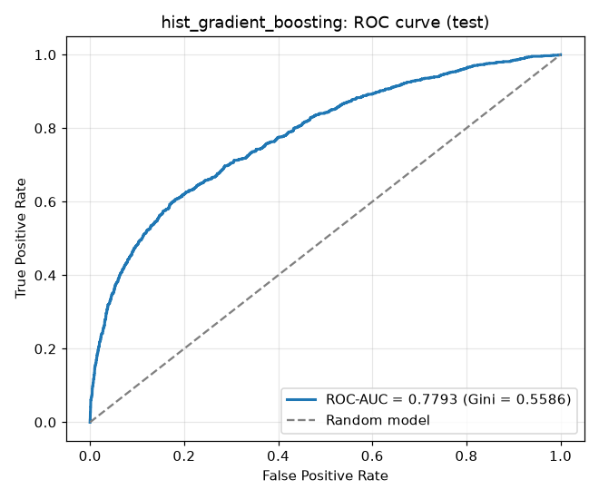
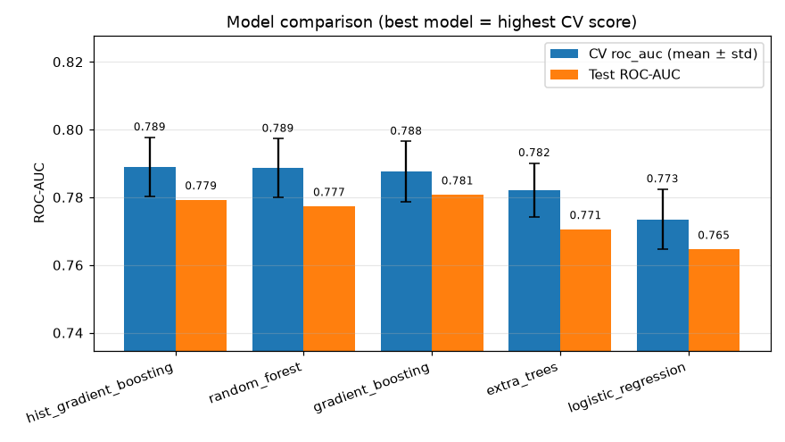
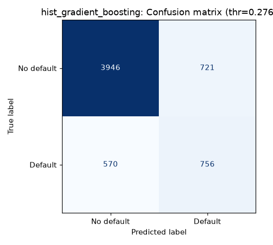
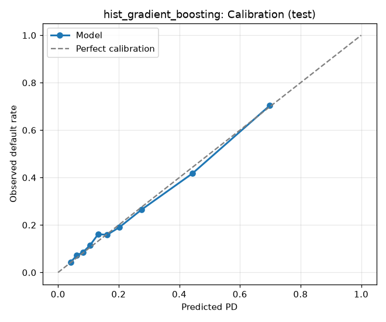
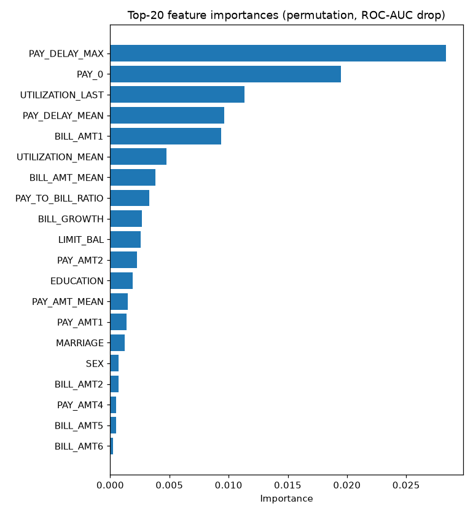
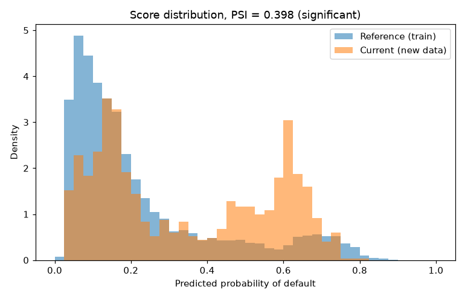
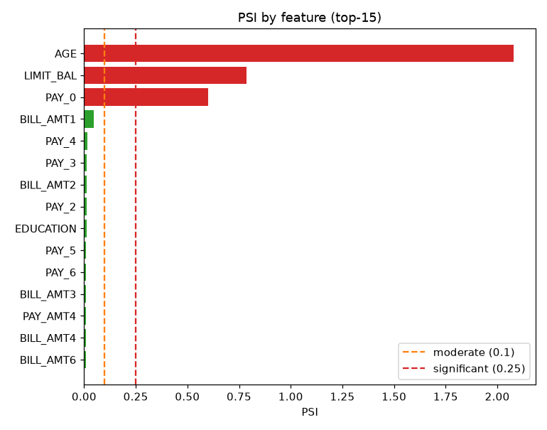

# Credit Scoring: PD-модель с end-to-end MLOps-пайплайном

Итоговый проект по дисциплине «Автоматизация процессов разработки и тестирования моделей машинного обучения».

Модель предсказывает **вероятность дефолта (PD)** клиента кредитной карты в следующем месяце.
Проект покрывает весь жизненный цикл модели: версионирование данных → валидация → feature engineering →
подбор гиперпараметров с трекингом экспериментов → тесты и CI → REST API в Docker → мониторинг дрифта.

**Датасет:** [Default of Credit Card Clients](https://archive.ics.uci.edu/dataset/350/default+of+credit+card+clients) (UCI), 30 000 клиентов, 23 признака,
целевая переменная `default.payment.next.month` (22% дефолтов).

## Стек

| Задача | Инструмент |
|---|---|
| Код и версии кода | Git, GitHub |
| Версии данных и моделей, пайплайн | **DVC** (`dvc.yaml`, `dvc.lock`, `params.yaml`) |
| Валидация данных | **Great Expectations** 1.x |
| Модель | **scikit-learn** Pipeline + GridSearchCV / RandomizedSearchCV |
| Трекинг экспериментов, Model Registry | **MLflow** |
| Тесты, качество кода | pytest, pytest-cov, flake8, black |
| CI | **GitHub Actions** |
| Сервинг | **FastAPI** + Uvicorn, **Docker** |
| Мониторинг | PSI (Population Stability Index) |

## Структура проекта

```
.
├── .github/workflows/ci-cd.yml   # CI: линтинг, GE-валидация, тесты, сборка Docker + smoke-тест API
├── data/
│   ├── raw/                      # исходные данные (UCI_Credit_Card.csv под DVC, в git только .dvc-файл)
│   ├── processed/                # train.csv / test.csv (выход стадии prepare, под DVC)
│   ├── expectations/             # набор правил Great Expectations (JSON)
│   └── sample/                   # 2000 строк для CI и тестов (в git)
├── models/                       # модель .pkl и эталонные скоры (под DVC), model_meta.json
├── notebooks/
│   ├── 01_eda.ipynb              # разведочный анализ → обоснование очистки и признаков
│   └── 02_mlflow_experiments.ipynb  # анализ экспериментов MLflow, модель из Model Registry
├── reports/                      # метрики, графики, сводка экспериментов, отчёты валидации и дрифта
├── scripts/
│   ├── docker_build_and_run.sh / .ps1   # сборка образа, запуск контейнера, проверка API
│   ├── smoke_test_api.py         # проверка работающего API
│   └── create_sample.py          # выборка данных для CI
├── src/
│   ├── config.py                 # константы и чтение params.yaml
│   ├── data/
│   │   ├── make_dataset.py       # загрузка, очистка, train/test split
│   │   └── validation.py         # Great Expectations suite + валидация
│   ├── features/build_features.py   # Feature Engineering (sklearn-трансформер)
│   ├── models/
│   │   ├── pipeline.py           # sklearn Pipeline + GridSearch/RandomizedSearch
│   │   ├── train.py              # обучение 5 алгоритмов + MLflow
│   │   ├── evaluate.py           # метрики (ROC-AUC, Gini, KS, P/R/F1...) и графики
│   │   └── predict.py            # загрузка модели и предсказание
│   ├── api/                      # FastAPI: app.py, schemas.py
│   └── monitoring/               # drift.py (PSI), simulate_traffic.py
├── tests/                        # 78 pytest-тестов
├── Dockerfile
├── dvc.yaml / dvc.lock           # DVC-пайплайн validate → prepare → train
├── params.yaml                   # все параметры (сплит, CV, сетки гиперпараметров, MLflow)
├── requirements.txt              # runtime-зависимости (в Docker-образ)
├── requirements-dev.txt          # + тесты, линтеры, DVC, Jupyter
└── pyproject.toml                # настройки black, pytest, coverage
```

## Быстрый старт

Нужны Python 3.11, Git, Docker. Команды выполняются из корня репозитория.

```bash
# 1. Окружение
python -m venv .venv
source .venv/bin/activate            # Windows: .venv\Scripts\activate
pip install -r requirements-dev.txt

# 2. Данные: из DVC-remote или вручную
dvc pull                             # если настроен доступ к remote
# либо положить UCI_Credit_Card.csv в data/raw/

# 3. Весь пайплайн: валидация → подготовка → обучение (≈8–10 минут)
dvc repro

# 4. Результаты
dvc metrics show
mlflow ui --backend-store-uri sqlite:///mlflow.db --port 5000   # http://localhost:5000
```

### Тесты и качество кода

```bash
pytest --cov=src          # 78 тестов
black --check .
flake8 .
python -m src.data.validation --input data/sample/credit_sample.csv   # GE-валидация
```

### API в Docker

```bash
./scripts/docker_build_and_run.sh            # Linux/macOS/Git Bash
.\scripts\docker_build_and_run.ps1           # Windows PowerShell
```

Скрипт собирает образ `credit-scoring-api`, запускает контейнер на порту 8000 и прогоняет smoke-тест.
Swagger UI: http://localhost:8000/docs. Без Docker: `uvicorn src.api.app:app --reload --port 8000`.

```bash
curl -X POST http://localhost:8000/predict -H "Content-Type: application/json" -d '{
  "LIMIT_BAL": 50000, "SEX": 2, "EDUCATION": 2, "MARRIAGE": 1, "AGE": 35,
  "PAY_0": 2, "PAY_2": 2, "PAY_3": 0, "PAY_4": 0, "PAY_5": 0, "PAY_6": 0,
  "BILL_AMT1": 46990, "BILL_AMT2": 48233, "BILL_AMT3": 49291, "BILL_AMT4": 28314,
  "BILL_AMT5": 28959, "BILL_AMT6": 29547, "PAY_AMT1": 2000, "PAY_AMT2": 2019,
  "PAY_AMT3": 1200, "PAY_AMT4": 1100, "PAY_AMT5": 1069, "PAY_AMT6": 1000}'
```

### Мониторинг дрифта

```bash
python -m src.monitoring.simulate_traffic --api-url http://localhost:8000            # обычный поток
python -m src.monitoring.simulate_traffic --api-url http://localhost:8000 --drift    # с искусственным дрифтом
```

## DVC-пайплайн

```
validate ──► prepare ──► train
```

| Стадия | Команда | Что делает | Выходы |
|---|---|---|---|
| `validate` | `python -m src.data.validation` | Great Expectations: ~100 правил (схема, типы, пропуски, диапазоны, коды категорий, уникальность ID, доля дефолтов). При нарушении — код 1, пайплайн останавливается | `data/expectations/credit_data_suite.json`, `reports/validation/raw_data_validation.json` |
| `prepare` | `python -m src.data.make_dataset` | удаление `ID` и 35 дубликатов, приведение типов, стратифицированный split 80/20 | `data/processed/train.csv`, `test.csv` |
| `train` | `python -m src.models.train` | подбор гиперпараметров 5 алгоритмов, MLflow, выбор лучшей модели по CV | `models/*.pkl`, `models/model_meta.json`, `reports/metrics.json`, `reports/figures/*` |

Исходный датасет добавлен через `dvc add` (`data/raw/UCI_Credit_Card.csv.dvc`), выходы стадий версионируются в `dvc.lock`,
remote по умолчанию — локальная папка `../dvc-storage` (заменяется на S3/GDrive командой `dvc remote modify`).
Если remote недоступен, CSV можно взять с [Kaggle](https://www.kaggle.com/datasets/uciml/default-of-credit-card-clients-dataset)
и положить в `data/raw/`.

## Данные и Feature Engineering

Подробный EDA — в [`notebooks/01_eda.ipynb`](notebooks/01_eda.ipynb). Ключевые наблюдения → решения:

| Наблюдение | Решение |
|---|---|
| 22% дефолтов (дисбаланс) | стратификация, ROC-AUC/PR-AUC, подбор порога, `class_weight` в сетке |
| недокументированные коды `EDUCATION` (0, 5, 6) и `MARRIAGE` (0) | объединение в «другое»; допустимые коды проверяет GE |
| U-образная зависимость риска от возраста | биннинг возраста `AGE_BIN` |
| история просрочек — сильнейший и нелинейный сигнал | `PAY_0` как категория + `PAY_DELAY_MAX/MEAN`, `N_MONTHS_DELAYED`, `N_MONTHS_NO_CONSUMPTION` |
| суммы скошены, важны относительные величины | `UTILIZATION_LAST/MEAN`, `PAY_TO_BILL_RATIO`, `BILL_GROWTH`, `BILL_AMT_MEAN`, `PAY_AMT_MEAN` |

Признаки считаются трансформером `FeatureEngineer` **внутри** sklearn Pipeline, поэтому API принимает «сырые» поля клиента,
а обучение и инференс используют один и тот же код. Инженерные признаки сильнее исходных:
univariate ROC-AUC `PAY_DELAY_MEAN` = 0.73 против 0.69 у лучшего исходного `PAY_0`; в permutation importance
итоговой модели `PAY_DELAY_MAX` — признак №1.

## Модель и эксперименты

**Pipeline:** `FeatureEngineer` → `ColumnTransformer` (числовые: `SimpleImputer(median)` + `StandardScaler`;
категориальные: `SimpleImputer(constant)` + `OneHotEncoder(handle_unknown="ignore")`) → классификатор.

**Подбор гиперпараметров:** 5-кратная стратифицированная CV по ROC-AUC; сетки — в `params.yaml`
(`GridSearchCV` для логистической регрессии, `RandomizedSearchCV` для ансамблей). Лучшая модель выбирается
**по CV**, тест используется только для итоговой оценки. Порог классификации подбирается по F1 на
out-of-fold предсказаниях обучающей выборки.

| Модель | CV ROC-AUC | Test ROC-AUC | Test Gini | Test KS | Brier | Время подбора |
|---|---|---|---|---|---|---|
| **HistGradientBoosting** ✅ | **0.789 ± 0.009** | 0.779 | 0.559 | 0.425 | 0.135 | 13 с |
| RandomForest | 0.789 ± 0.009 | 0.777 | 0.555 | 0.422 | 0.168 | 2 мин |
| GradientBoosting | 0.788 ± 0.009 | 0.781 | 0.562 | 0.430 | 0.134 | 3 мин |
| ExtraTrees | 0.782 ± 0.008 | 0.771 | 0.541 | 0.405 | 0.136 | 1.3 мин |
| LogisticRegression | 0.773 ± 0.009 | 0.765 | 0.530 | 0.411 | 0.185 | 20 с |

**Итоговая модель (HistGradientBoosting) на отложенной выборке** (`reports/metrics.json`):

| ROC-AUC | Gini | KS | PR-AUC | Порог | Precision | Recall | F1 | Brier |
|---|---|---|---|---|---|---|---|---|
| 0.779 | 0.559 | 0.425 | 0.560 | 0.276 | 0.512 | 0.570 | 0.539 | 0.135 |

При стандартном пороге 0.5 recall был бы только 0.37 (F1 0.47): подбор порога позволяет ловить на ~55% больше дефолтов.

<p>
  
  
</p>
<p>
  
  
  
</p>

**Анализ экспериментов:**
- три ансамбля деревьев (HistGB, RF, GB) статистически эквивалентны (разница 0.001–0.002 < std по фолдам 0.009);
  HistGB выбрана как лучшая по CV, к тому же она в 10–15 раз быстрее и хорошо откалибрована;
- у GradientBoosting на тесте ROC-AUC чуть выше, но выбор по тесту был бы подгонкой под тестовую выборку;
- разрыв CV → test ≈ 0.01 у всех моделей — переобучения нет;
- `class_weight="balanced"` (лучшие конфигурации LogReg и RF) улучшает ранжирование, но завышает PD (Brier 0.17–0.19),
  что критично для PD-модели;
- линейная модель отстаёт на ~0.015 ROC-AUC: зависимости (просрочки, возраст) нелинейны.

## MLflow

Трекинг: `sqlite:///mlflow.db`, артефакты — `mlruns/`. Эксперимент `credit-default-pd`:

- **родительский run на каждый алгоритм** — параметры поиска и лучшие гиперпараметры, все параметры модели,
  CV- и test-метрики, графики (ROC, PR, confusion matrix, калибровка, распределение скоров, важность признаков),
  `cv_results.csv`, classification report, модель (`mlflow.sklearn.log_model` с сигнатурой и input example),
  версии train/test (MLflow Datasets);
- **вложенный run на каждую комбинацию гиперпараметров** (~60 штук);
- **Model Registry:** лучшая модель регистрируется как `CreditDefaultModel` с алиасом `champion`.

```bash
mlflow ui --backend-store-uri sqlite:///mlflow.db --port 5000
```

Программный анализ runs и загрузка модели из реестра (`models:/CreditDefaultModel@champion`) —
[`notebooks/02_mlflow_experiments.ipynb`](notebooks/02_mlflow_experiments.ipynb).

## Тестирование и CI

78 тестов (`pytest --cov=src`, покрытие ≈82%):

| Файл | Что проверяет |
|---|---|
| `test_make_dataset.py` | очистка, дубликаты, стратифицированный и воспроизводимый split |
| `test_features.py` | каждый инженерный признак, биннинг возраста, отсутствие inf/NaN, схема выхода трансформера |
| `test_validation.py` | данные проходят GE-валидацию; **8 типов аномалий** (null, выход за диапазон, неизвестная категория, неверный таргет, нет колонки, отрицательный платёж, неверный тип, сдвиг доли дефолтов) — валидация падает; CLI возвращает код 1 |
| `test_metrics.py` | метрики совпадают с эталоном sklearn, оптимальность порога |
| `test_pipeline.py` | все 5 моделей из `params.yaml` обучаются и предсказывают, поиск гиперпараметров, применение порога |
| `test_api.py` | `/`, `/health`, `/model-info`, `/predict`, `/predict_batch`, ответы 422 и 503 |
| `test_drift.py` | PSI: ≈0 на одинаковых данных, растёт со сдвигом, пустые корзины, категориальный PSI |
| `test_train.py` | интеграционный: подготовка → обучение → артефакты → MLflow runs → Model Registry |

**GitHub Actions** (`.github/workflows/ci-cd.yml`) на каждый push и pull request:

1. `lint` — `black --check`, `flake8`;
2. `data-validation` — Great Expectations на `data/sample/credit_sample.csv` (отчёт — артефакт сборки);
3. `test` — pytest с покрытием;
4. `docker` (после успеха 1–3) — обучение быстрой модели на выборке, `docker build`, запуск контейнера,
   smoke-тест API и проверка мониторинга дрифта против работающего контейнера.

## API

| Метод | Путь | Описание |
|---|---|---|
| GET | `/` | проверка, что сервис жив |
| GET | `/health` | загружена ли модель (используется в `HEALTHCHECK` Docker) |
| GET | `/model-info` | алгоритм, порог, test-метрики, версия в MLflow Registry |
| POST | `/predict` | один клиент → `default_prediction` (0/1) и `default_probability` |
| POST | `/predict_batch` | список клиентов |

Вход валидируется Pydantic-схемой с теми же ограничениями, что и в GE (возраст 18–100, известные коды категорий,
неотрицательные платежи, запрет лишних полей) → `422` при ошибке.

```json
{"default_prediction": 1, "default_probability": 0.627489, "threshold": 0.276298, "model_name": "hist_gradient_boosting"}
```

## Мониторинг дрифта

`src/monitoring/simulate_traffic.py` берёт 1000 клиентов из тестовой выборки, отправляет каждого в `/predict`
и сравнивает с обучающими данными через **PSI** (Population Stability Index):
PSI распределения скоров модели + PSI каждого из 23 признаков. Пороги: < 0.1 — стабильно, 0.1–0.25 — умеренный сдвиг,
≥ 0.25 — значимый (нужна перепроверка/переобучение). Флаг `--drift` моделирует «кризис» (лимиты −40%, возраст +7 лет,
рост просрочек у 35% клиентов), `--fail-on-drift` возвращает код 1 (для использования в CI/планировщике).

Результаты (1000 запросов к API в Docker, отчёты — `reports/monitoring/*/drift_report.md`):

| Сценарий | PSI скора | Статус | Признаки со значимым дрифтом | ROC-AUC на новых данных | Средняя PD |
|---|---|---|---|---|---|
| обычный поток (holdout) | 0.0075 | stable | — | 0.757 | 0.222 → 0.213 |
| синтетический «кризис» (`--drift`) | 0.3985 | **significant** | `AGE` (2.08), `LIMIT_BAL` (0.78), `PAY_0` (0.60) | 0.660 | 0.222 → 0.344 |

<p>
  
  
</p>

Мониторинг ловит сдвиг и по скору, и по конкретным признакам; падение ROC-AUC на «кризисных» данных
(0.78 → 0.66) подтверждает, что значимый PSI — сигнал к переобучению модели.

## Воспроизводимость

- все случайности фиксированы (`random_state: 42` в `params.yaml`), повторный `dvc repro` даёт те же метрики;
- версии библиотек закреплены в `requirements*.txt`; Docker-образ собирается на тех же версиях;
- `dvc.lock` хранит хэши данных, кода, параметров и результатов каждой стадии.
